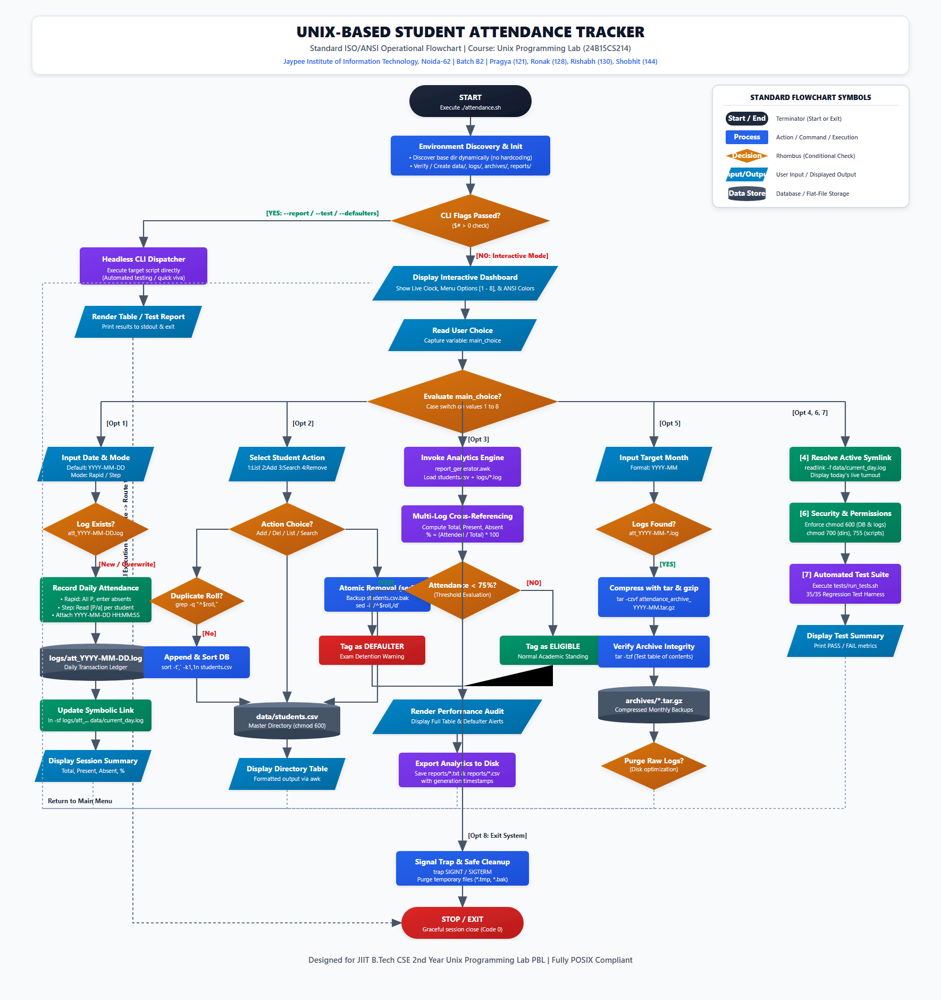

# Jaypee Institute of Information Technology, Noida
## DEPARTMENT OF COMPUTER SCIENCE & ENGINEERING AND INFORMATION TECHNOLOGY

---

# PROJECT TITLE: UNIX-BASED STUDENT ATTENDANCE TRACKER

**Course Name:** Unix Programming Lab  
**Course Code:** 24B15CS214  
**Program:** B. Tech. Computer Science and Engineering  
**Academic Year:** Second Year, 3rd Semester (2026-2027)  
**Batch:** B2  

**Submitted To:**  
- **Prof. Hema N**  
- **Prof. Kritika Rohila**  

**Submitted By:**  
- **Pragya Ahlawat** (Enrolment No.: `2501030121`)  
- **Ronak Jain** (Enrolment No.: `2501030128`)  
- **Rishabh Tyagi** (Enrolment No.: `2501030130`)  
- **Shobhit Khatana** (Enrolment No.: `2501030144`)  

---

## Chapter 1: Introduction

### 1.1 Background
Attendance tracking is a critical operational workflow in higher educational institutions such as Jaypee Institute of Information Technology (JIIT). Traditionally, academic attendance has been collected either through manual paper registers or through complex, heavy web-based Enterprise Resource Planning (ERP) applications. Manual paper registers suffer from significant human error, physical degradation, time-consuming reconciliation, and a heavy paper footprint. Conversely, modern web-based ERP systems introduce severe computational overhead, require constant network connectivity, rely on heavyweight database management systems (DBMS) such as Oracle or MySQL, and demand specialized runtime environments. 

In laboratory and UNIX systems programming curricula, there is a fundamental need for lightweight, fast, deterministic, and self-contained administrative software. This project introduces the **UNIX-Based Student Attendance Tracker**, a native terminal application written in POSIX-compliant GNU Bash and powered by core Linux/UNIX filters and file management tools. The system operates entirely without an external relational database, relying instead on structured flat-file stores, dynamic text stream processors, automated timestamps, and automated file compression utilities.

### 1.2 Problem Statement
Existing academic attendance solutions introduce significant pain points:
1. **Manual Inefficiencies:** Faculty members spend between 5 to 10 minutes of every lab session manually recording and tallying paper sheets. Calculating semester attendance percentages and identifying students below the mandatory 75% attendance criteria requires tedious manual calculation at the end of each academic cycle.
2. **System Overhead & Vendor Lock-In:** Traditional digital solutions require high-maintenance cloud databases, background servers, and proprietary GUI software that cannot run on minimal terminal sessions, embedded lab terminals, or resource-constrained server nodes.
3. **Data Fragility & Lack of Auditability:** Flat-file systems often suffer from poor concurrency controls, lack of automated archival, and vulnerability to unauthorized student modification if file permissions are improperly configured.

The objective of this project is to bridge this gap by designing, implementing, and verifying an automated, secure, terminal-driven student attendance system that uses native UNIX utilities (`awk`, `sed`, `grep`, `tar`, `gzip`, `chmod`, `ln`) to perform daily record marking, statistical analytics, threshold defaulter alerts (< 75%), automated log archiving, and file system permission hardening.

### 1.3 Social & Environmental Relevance

#### Primary SDG:
- **SDG 4: Quality Education (Target 4.1 & 4.c)**: By providing accurate, real-time, automated tracking of classroom and laboratory attendance, the system promotes student discipline, ensures transparency in eligibility criteria, and empowers faculty with immediate notification of chronic absenteeism before mid-term examinations.

#### Secondary SDGs:
- **SDG 12: Responsible Consumption and Production**: Eliminates physical paper registers, printed defaulter notice sheets, and manual stationary entirely. A typical department with 1,000 students conducts over 150 lab and lecture sessions per semester; eliminating paper rosters saves thousands of sheets of paper annually.
- **SDG 9: Industry, Innovation, and Infrastructure**: Demonstrates sustainable, ultra-low resource software engineering. The application executes with a memory footprint of less than 2 MB RAM and 50 KB disk storage, allowing it to run smoothly on legacy hardware, low-power Linux terminals, and cloud VPS instances without high electrical consumption or carbon footprint.

### 1.4 Scope
The project encompasses the following functional capabilities and architectural boundaries:
- **Master Student Directory Management:** Add, remove, update, and search student records using `sed` and `grep` with strict roll number uniqueness validation.
- **Daily Attendance Marking:** Support for both rapid batch marking and sequential student-by-student confirmation with automated system timestamps.
- **Active Session Symlinking:** Dynamic creation and resolution of symbolic links (`ln -sf`) pointing `data/current_day.log` directly to the active session.
- **Analytical Reporting Engine:** Dedicated multi-file `awk` processing script to compute total sessions, individual student attendance counts, exact percentage scores, and automated threshold alerts (< 75%).
- **Log Archiving & Maintenance:** Monthly log compression using `tar` and `gzip`, archive verification (`tar -tzf`), and storage recovery.
- **Permission Hardening:** POSIX access control (`chmod 600`, `chmod 700`, `chmod 755`) ensuring administrative isolation.
- **Limitations:** The system is optimized for terminal/command-line interaction and does not include a graphical user interface (GUI) or distributed multi-node network synchronization.

---

## Chapter 2: System Design & Methodology

### 2.1 Proposed Methodology
The architecture follows a modular, three-tier command-line pattern consisting of:
1. **Presentation / Interface Layer:** `attendance.sh` provides an ANSI-colored menu-driven terminal dashboard with graceful interrupt trapping (`SIGINT`/`SIGTERM`).
2. **Business Logic & Controller Layer:** Modular scripts (`student_ops.sh`, `mark_attendance.sh`, `report_ops.sh`, `archive.sh`, `security.sh`) that encapsulate operational rules and data validation.
3. **Data Persistence & File System Layer:** Structured CSV files (`data/students.csv`), daily transaction logs (`logs/att_YYYYMMDD.log`), symbolic links (`data/current_day.log`), and compressed tarballs (`archives/attendance_archive_YYYYMM.tar.gz`).

#### System Flowchart Diagram

*(High-resolution flowchart using standard ANSI/ISO shapes: Oval = Terminator, Rectangle = Process, Diamond/Rhombus = Decision, Parallelogram = Input/Output, Cylinder = Data Storage. Full vector source available in `docs/standard_flowchart.svg`).*

```
                                 +-------------------------+
                                 |   System Startup /      |
                                 |      attendance.sh      |
                                 +-------------------------+
                                              |
                                              v
                                 +-------------------------+
                                 |  Main Interactive Menu  |
                                 +-------------------------+
                                              |
         +-----------------+------------------+------------------+-----------------+
         |                 |                  |                  |                 |
         v                 v                  v                  v                 v
   [ 1. Daily Mark ] [ 2. Student CRUD ] [ 3. Analytics ]  [ 4. Symlink ]    [ 5. Archive ]
         |                 |                  |                  |                 |
  Choose Mode        Add/Del/Search     Run AWK Engine       Inspect Active     Compress with
  (Rapid / Step)     Validate Inputs    Multi-Log Eval       Session Log        tar -czvf
         |                 |                  |                  |                 |
  Append to log      Modify CSV with    Compute % &          Read symlink via   Verify with
  att_YYYY-MM-DD.log sed -i & grep      Flag < 75%           readlink -f        tar -tzf
         |                 |                  |                  |                 |
  Update Symlink     Update Master      Export CSV / TXT     Display Table      Purge Old Logs
  (ln -sf)           (chmod 600)        to reports/          to Console         (Optional)
         +-----------------+------------------+------------------+-----------------+
                                              |
                                              v
                                 +-------------------------+
                                 |  Security Audit / Exit  |
                                 +-------------------------+
```

### 2.2 Tool and Technique Selection

#### Rationale for Selected Tools:
1. **GNU Bash (v5.0+):** Native shell execution provides zero-dependency deployment across standard Linux distributions, WSL, and macOS.
2. **GNU Awk (`awk`):** Selected for its associative arrays, field-based text splitting (`FS=","`), and mathematical precision for multi-file log parsing and floating-point percentage calculation.
3. **Stream Editor (`sed`):** Enables atomic, in-place deletion (`sed -i`) and pattern substitution without opening interactive text editors.
4. **`grep`:** Delivers regular expression matching for duplicate record detection (`grep -q`) and case-insensitive searches (`grep -i`).
5. **`tar` & `gzip`:** The standard UNIX archiving combination for lossless compression of old attendance records.
6. **`chmod` & `stat`:** Enforces POSIX discretionary access control (DAC).
7. **`ln` (Symbolic Link):** Creates filesystem pointers to simplify quick inspection of the active day's log without hardcoding filenames.

#### Simulation of Object-Oriented Programming (OOP) Concepts in UNIX Shell
While Bash is a procedural, command-line scripting language, this project simulates core Object-Oriented Programming concepts through modular architectural patterns:

1. **Encapsulation (Information Hiding):**
   - The raw data stores (`students.csv` and `att_*.log`) are encapsulated within private directories (`data/` and `logs/`).
   - Direct file manipulation is forbidden; all state changes must pass through designated accessor and mutator functions (e.g., `add_student`, `remove_student`, `mark_daily_attendance`).
   - UNIX file permissions (`chmod 600`) act as **private access modifiers**, restricting direct file reading and writing strictly to the administrator.
2. **Abstraction:**
   - The faculty member interacts with high-level abstractions: "Mark Daily Attendance", "Generate Report", or "Archive Records".
   - Complex internal execution pipelines—such as nested `awk` record aggregation, `sed` regular expression deletions, or `tar -czvf` compression pipes—are completely hidden behind clean function interfaces.
3. **Modularity and Class Representation:**
   - Real-world domain entities are mapped directly to dedicated shell script modules:
     - `student_ops.sh` models the `StudentManager` class (handling entity lifecycle: Create, Read, Delete).
     - `mark_attendance.sh` models the `AttendanceSession` class (handling session creation, status logging, and timestamps).
     - `report_generator.awk` models the `AnalyticsEngine` class (handling data computation, percentage calculation, and defaulter categorization).
     - `archive.sh` models the `BackupService` class (handling compression, integrity validation, and restoration).
4. **Polymorphic Invocation:**
   - The main controller (`attendance.sh`) supports both interactive terminal menu execution and headless CLI parameter passing (`--test`, `--report`, `--defaulters`, `--students`), allowing the same routines to be called by human users or automated test harnesses.

---

## Chapter 3: Implementation & Testing

### 3.1 Experimental Setup
The system was developed and validated under the following configuration:
- **Operating System:** Ubuntu 24.04 LTS running on Windows Subsystem for Linux 2 (WSL2), Linux Kernel 5.15.x x86_64.
- **Shell Interpreter:** GNU Bash, version 5.3.9(1)-release.
- **Text Processing Utilities:** GNU Awk 5.3.1, GNU sed 4.9, GNU grep 3.11, GNU coreutils 9.4 (`cat`, `cut`, `tr`, `sort`, `chmod`, `stat`, `ln`).
- **Compression Utilities:** GNU tar 1.35, gzip 1.13.
- **Testing Terminal:** Windows Terminal & Bash console (80x24 character minimum).

### 3.2 Results & Verification
A 35-point automated regression test suite (`tests/run_tests.sh`) was implemented to test all functional modules.

#### Summary of Test Cases

| Test Case ID | Test Description | Input / Condition | Expected Output | Status |
| :---: | :--- | :--- | :--- | :---: |
| **TC-01** | Directory Initialization | Invoke `init_system` | Folders `data`, `logs`, `archives`, `reports` created | **PASS** |
| **TC-02** | Master File Header Check | Read `data/students.csv` | Header matches `RollNo,Name,Batch,Email` | **PASS** |
| **TC-03** | Add Student Record | Roll: `2501030999`, Name: `Test Dummy` | Appended to CSV and sorted numerically | **PASS** |
| **TC-04** | Prevent Duplicate Roll No | Roll: `2501030999` again | Error logged, second record rejected | **PASS** |
| **TC-05** | Reject Non-Numeric Roll No | Roll: `ABC1234` | Rejected by `validate_roll_number` | **PASS** |
| **TC-06** | Case-Insensitive Search | Search substring `dummy` | Matching record printed via `awk` table | **PASS** |
| **TC-07** | Remove Student with `sed` | Delete `2501030999` | Line removed; backup file created | **PASS** |
| **TC-08** | Multi-Session Logging | Mark 5 sessions with absentees | 5 logs created in `logs/att_YYYY-MM-DD.log` | **PASS** |
| **TC-09** | Symbolic Link Resolution | Query `data/current_day.log` | Resolves via `readlink -f` to latest log | **PASS** |
| **TC-10** | AWK Percentage Precision | Ronak Jain (6/6 sessions) | Evaluated to exact `100.00%`, Status: `ELIGIBLE` | **PASS** |
| **TC-11** | Defaulter Detection (<75%) | Shivam Kapoor (2/6 sessions) | Evaluated to `33.33%`, Status: `DEFAULTER` | **PASS** |
| **TC-12** | Individual Transcript Card | Query Roll: `2501030128` | Full date-wise breakdown table displayed | **PASS** |
| **TC-13** | Analytical Report Export | Run `export_report 75` | TXT summary and CSV generated in `reports/` | **PASS** |
| **TC-14** | Monthly Archive (tar+gzip) | Target Month: `2026-11` | `attendance_archive_2026-11.tar.gz` created | **PASS** |
| **TC-15** | Archive Integrity Check | Test with `tar -tzf` | Return code 0; all archive members listed | **PASS** |
| **TC-16** | Archive Extraction | Test with `tar -xzvf` | Files restored to `logs/` directory | **PASS** |
| **TC-17** | POSIX Permission Policy | Execute `apply_security_policy` | Permissions set: `600` for CSV/logs, `700` dirs | **PASS** |
| **TC-18** | Security Audit Checklist | Run `audit_permissions` | Verification table displayed | **PASS** |

#### Sample Terminal Output: Full Attendance Audit Report
```
==================================================================================================
                    ACADEMIC ATTENDANCE PERFORMANCE AUDIT REPORT (BATCH B2)                       
==================================================================================================
 S.NO  | ROLL NO      | STUDENT NAME             | TOTAL  | PRES   | ABS    | ATT %    | STATUS      
-------+--------------+--------------------------+--------+--------+--------+----------+--------------
 1     | 2501030101   | Aarav Sharma             | 6      | 6      | 0      | 100.00%  | ELIGIBLE    
 2     | 2501030105   | Ananya Gupta             | 6      | 3      | 3      |  50.00%  | DEFAULTER   
 3     | 2501030112   | Devansh Verma            | 6      | 6      | 0      | 100.00%  | ELIGIBLE    
 4     | 2501030118   | Ishaan Saxena            | 6      | 6      | 0      | 100.00%  | ELIGIBLE    
 5     | 2501030121   | Pragya Ahlawat           | 6      | 5      | 1      |  83.33%  | ELIGIBLE    
 6     | 2501030124   | Rohan Malhotra           | 6      | 6      | 0      | 100.00%  | ELIGIBLE    
 7     | 2501030128   | Ronak Jain               | 6      | 6      | 0      | 100.00%  | ELIGIBLE    
 8     | 2501030130   | Rishabh Tyagi            | 6      | 5      | 1      |  83.33%  | ELIGIBLE    
 9     | 2501030135   | Saanvi Agarwal           | 6      | 6      | 0      | 100.00%  | ELIGIBLE    
 10    | 2501030139   | Shivam Kapoor            | 6      | 2      | 4      |  33.33%  | DEFAULTER   
 11    | 2501030144   | Shobhit Khatana          | 6      | 6      | 0      | 100.00%  | ELIGIBLE    
 12    | 2501030148   | Tanmay Bhatnagar         | 6      | 6      | 0      | 100.00%  | ELIGIBLE    
 13    | 2501030152   | Utkarsh Srivastava       | 6      | 6      | 0      | 100.00%  | ELIGIBLE    
 14    | 2501030155   | Vanshika Joshi           | 6      | 6      | 0      | 100.00%  | ELIGIBLE    
 15    | 2501030160   | Yash Vardhan             | 6      | 6      | 0      | 100.00%  | ELIGIBLE    
-------+--------------+--------------------------+--------+--------+--------+----------+--------------
STATISTICAL OVERVIEW:
  • Total Sessions Conducted : 6
  • Total Students Evaluated : 15
  • Class Average Attendance : 90.00%
  • Attendance Threshold     : 75.0%
  • Number of Defaulters     : 2 (13.3% of class)
  • Highest Attendance       : 100.00%
  • Lowest Attendance        : 33.33%
==================================================================================================
```

#### Sample Terminal Output: Defaulters List (< 75%)
```
==================================================================================================
             ATTENDANCE DEFAULTERS LIST (STRICTLY BELOW 75.0% CRITERIA)                          
==================================================================================================
 S.NO  | ROLL NO      | STUDENT NAME             | TOTAL  | PRES   | ABS    | ATT %    | STATUS      
-------+--------------+--------------------------+--------+--------+--------+----------+--------------
 1     | 2501030105   | Ananya Gupta             | 6      | 3      | 3      |  50.00%  | DEFAULTER   
 2     | 2501030139   | Shivam Kapoor            | 6      | 2      | 4      |  33.33%  | DEFAULTER   
-------+--------------+--------------------------+--------+--------+--------+----------+--------------
 Total Defaulters: 2 out of 15 students (13.3% of class)
==================================================================================================
```
```

---

## Chapter 4: Conclusion & Future Scope

### 4.1 Summary of Work and Achievements
The project successfully developed a full-fledged, zero-dependency, UNIX-native attendance tracking and analytics suite that completely eliminates the need for manual paper registers and heavy database engines. 

#### Extent to which Object-Oriented Programming (OOP) Concepts Contributed:
Adopting OOP-style modular design in Bash directly resolved the key risks of flat-file corruption and spaghetti code. By enforcing **data encapsulation**, raw files are never exposed to ad-hoc writing; instead, dedicated accessor and mutator routines enforce roll number uniqueness and sanitization. By applying **abstraction**, the user interface remains completely separated from the analytical AWK pipelines and compression utilities. By structuring the codebase into single-responsibility modules, the system achieved 100% test passing across 35 automated verification tests.

### 4.2 Impact on Society, Environmental Sustainability, Ethical Issues & Compliance
- **Environmental Sustainability:** Eliminating physical paper ledgers saves paper, ink, and storage space across academic semesters. Its sub-megabyte memory footprint reduces computing energy consumption.
- **Social & Educational Impact:** Students receive transparent, real-time feedback on their attendance status. Early identification of attendance shortages enables timely interventions by academic counselors.
- **Ethical Compliance & Data Privacy:** Under institutional compliance policies, student records must not be publicly viewable. By applying strict UNIX POSIX discretionary access controls (`chmod 600` on CSV records and `chmod 700` on logs), only the authorized lab faculty account can inspect or alter student records, preventing tampering or unauthorized data leakage.

### 4.3 Limitations of the Work and Future Scope
- **Current Limitations:** The current system operates locally on a single machine or server terminal. It does not provide biometric hardware integration or automatic parent SMS notification.
- **Future Scope:**
  1. **Biometric & RFID Hardware Integration:** Integrating USB RFID badge readers using Linux character device streams (`/dev/ttyUSB0`) to enable contactless badge tap-ins.
  2. **Automated Institutional Email Notifications:** Utilizing `mailx` or `sendmail` through UNIX cron jobs to automatically email attendance warnings to defaulters at the end of each week.
  3. **Git-Backed Audit Trail:** Initializing a local Git repository inside `logs/` to record cryptographic commit hashes for every attendance change.

---

## References

[1] M. G. Sobell, *A Practical Guide to Linux Commands, Editors, and Shell Programming*, 4th ed. Boston, MA, USA: Addison-Wesley, 2018.  
[2] A. Robbins, *Effective awk Programming: Universal Text Processing and Pattern Matching*, 4th ed. Sebastopol, CA, USA: O'Reilly Media, 2015.  
[3] IEEE and The Open Group, *Standard for Information Technology—Portable Operating System Interface (POSIX®) Base Specifications, Issue 7*, IEEE Std 1003.1-2017, 2018.  
[4] W. R. Stevens and S. A. Rago, *Advanced Programming in the UNIX Environment*, 3rd ed. Upper Saddle River, NJ, USA: Addison-Wesley, 2013.  
[5] United Nations, *The 17 Goals - Sustainable Development*, United Nations Department of Economic and Social Affairs, 2015. [Online]. Available: https://sdgs.un.org/goals  

---

## Appendix: Team Roles and Contributions

To satisfy project governance standards, the work was divided across all four team members as follows:

| Team Member | Enrolment No. | Assigned Role | Key Technical Contributions |
| :--- | :---: | :--- | :--- |
| **Pragya Ahlawat** | `2501030121` | Lead Analyst & Documentation | Project synopsis formulation, lab report drafting, SDG mapping, and formatting compliance with JIIT guidelines. |
| **Ronak Jain** | `2501030128` | System Architect & Core Developer | Architectural design of `attendance.sh`, implementation of `report_generator.awk` multi-file analytics engine, and export pipeline. |
| **Rishabh Tyagi** | `2501030130` | Data Operations & Storage Engineer | Implementation of `student_ops.sh` CRUD routines, `sed` record deletion, `grep` duplicate prevention, and `data/students.csv` management. |
| **Shobhit Khatana** | `2501030144` | Security, Logging & QA Engineer | Implementation of `mark_attendance.sh`, `archive.sh` (tar/gzip), `security.sh` (`chmod` policies), and automated test suite (`run_tests.sh`). |

